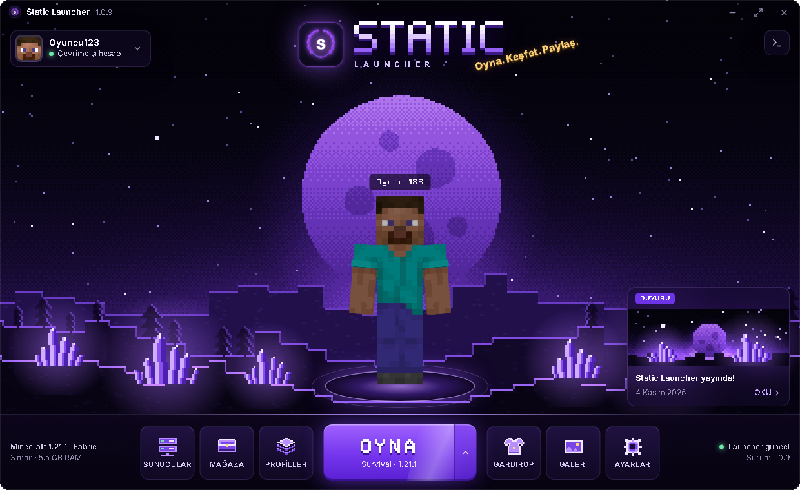
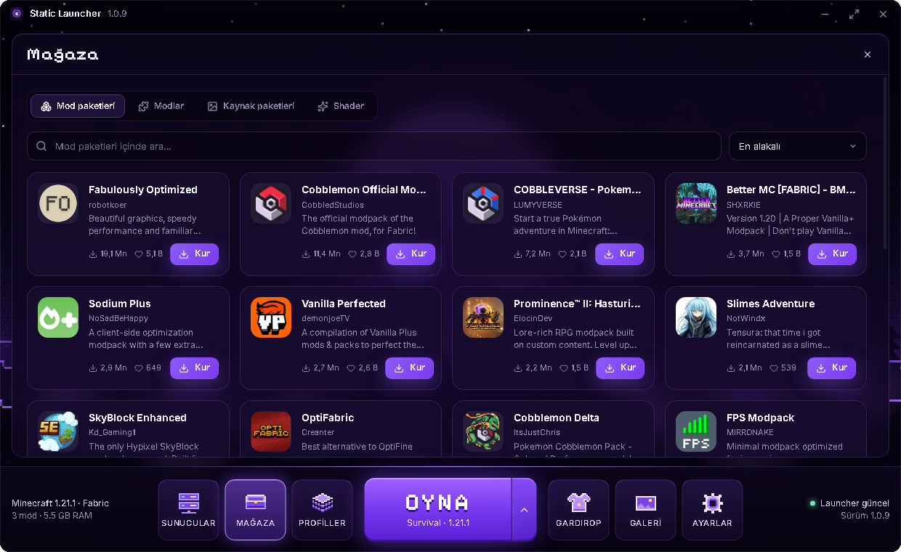
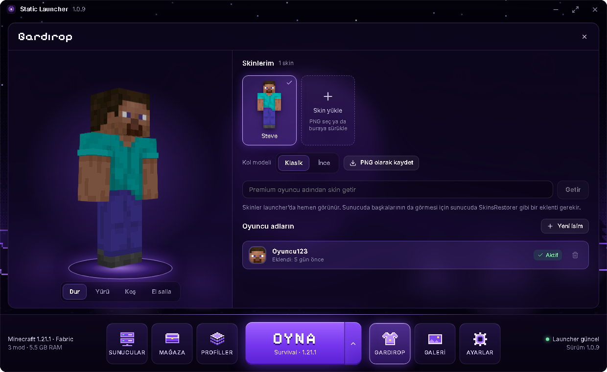
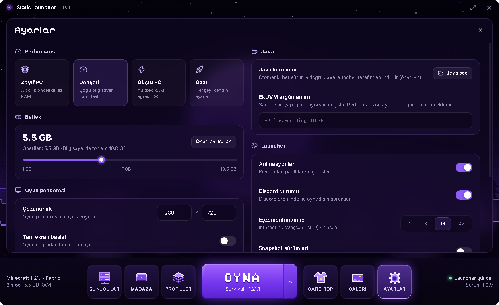
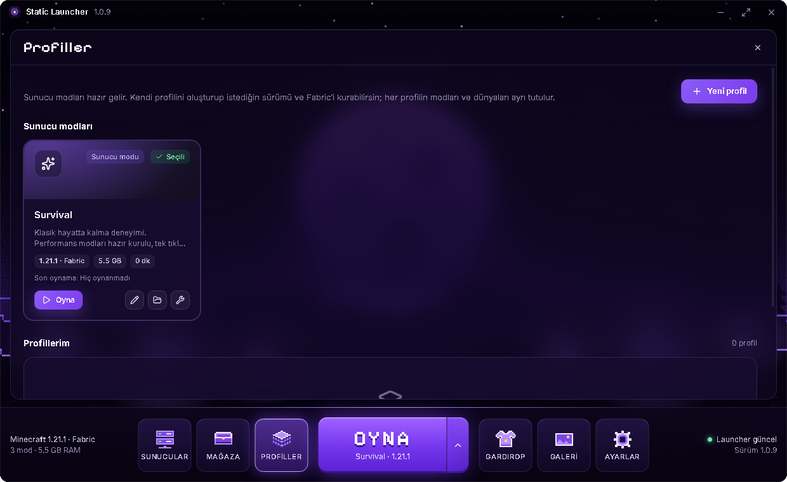

<div align="center">


# Static Launcher

**Oyna. Keşfet. Paylaş.**

Kendi dünyası olan, tek tıkla mod paketi kuran, Windows için Minecraft: Java Edition launcher'ı.

   



</div>

## Öne çıkanlar

- **Yaşayan ana ekran:** Kodla çizilen piksel dünya, ay, kristaller, kıvılcımlar ve 3D karakterin.
- **Mod paketleri:** Mağazadan tek tıkla kur, her paket kendi profilinde çalışsın.
- **Mağaza:** Modlar, kaynak paketleri ve shader'lar bağımlılıklarıyla kurulur.
- **Gardırop:** Skin koleksiyonu, sürükleyip yükleme ve karakter animasyonları.
- **Tek tıkla oyun:** Doğru Java sürümü ve oyun dosyaları otomatik iner, her dosya doğrulanır.
- **Sunucular:** Canlı durum, oyuncu sayısı ve doğrudan bağlanma.
- **Otomatik güncelleme:** Yeni sürüm çıkınca launcher haber verir, tek tıkla kurulur.
- **Dünya yedekleri ve galeri:** Dünyalarını yedekle, ekran görüntülerine tek yerden bak.

## Ekranlar

| Mağaza | Gardırop |
|---|---|
|  |  |

| Ayarlar | Profiller |
|---|---|
|  |  |

## English

Static Launcher is a Windows launcher for Minecraft: Java Edition, built for our community server. It installs game versions and Java automatically, manages profiles, servers and skins, and lets players browse and install mods, modpacks, resource packs and shaders from Modrinth. Downloads are hash-verified and come from the original hosts; no third-party files are re-hosted. The launcher currently supports offline-mode accounts only; Microsoft sign-in is not included.

> Static Launcher is not an official Minecraft product and is not affiliated with Mojang or Microsoft.

## Komutlar

```bash
npm install          # bağımlılıklar (ilk sefer)
npm run dev          # geliştirme modu (canlı yenileme)
npm run build        # derle
npm start            # derlenmiş hali çalıştır
npm test             # birim testleri
npm run typecheck    # TypeScript kontrolü
npm run dist         # Windows kurulum dosyası -> release/
```

## Sunucunu bağlamak: `resources/launcher.config.json`

Kod değiştirmeden launcher'ı kendi sunucuna göre ayarlarsın:

| Alan | Ne işe yarar |
|------|--------------|
| `name`, `tagline` | Launcher adı ve açılış ekranındaki slogan |
| `modes` | OYNA düğmesinin menüsündeki sunucu modları. `mcVersion` (`"latest"` olabilir), `loader` (`vanilla`/`fabric`), `mods` (Modrinth slug listesi, açılışta otomatik kurulur), `server` (oyun açılınca bağlanılacak adres), `accent` (renk) |
| `servers` | Sunucular sayfasında "Resmi" olarak görünen sunucular (`id`, `name`, `address`, `featured`) |
| `news` | Haberler sayfası |
| `links.discord`, `links.website` | Ana ekranın sağ üstündeki butonlar (sadece `https://`) |
| `discordClientId` | Discord Rich Presence için Discord Developer Portal'daki uygulama ID'si |
| `remoteConfigUrl` | Bu dosyanın internetteki kopyası. Doluysa launcher her açılışta haberleri, modları ve sunucuları buradan çeker; launcher'ı yeniden dağıtmana gerek kalmaz |
| `updateUrl` | Otomatik güncelleme için `npm run dist` çıktısını (`latest.yml` + `.exe`) koyduğun https klasörü |

## Güncelleme yayınlama

**İçerik (haber, mod listesi, sunucular)** — yeni sürüm gerekmez: `remoteConfigUrl` adresindeki JSON'u değiştir, oyuncular launcher'ı bir sonraki açışlarında görür.

**Launcher'ın kendisi (kod/tasarım değişikliği):**

1. `package.json` içindeki `version` değerini artır (ör. `1.0.0` → `1.0.1`) ve `resources/release-notes.md` dosyasına bu sürümdeki yenilikleri yaz (oyunculara güncelleme penceresinde gösterilir).
2. `npm run dist` çalıştır.
3. `release/` içindeki şu 3 dosyayı `updateUrl` klasörüne yükle (eskilerin üzerine yaz):
   `latest.yml`, `StaticLauncher-Setup-1.0.1.exe`, `StaticLauncher-Setup-1.0.1.exe.blockmap`
4. Launcher açılışta ve açıkken 15 dakikada bir kontrol eder; ortada "Yeni güncelleme var!" penceresi ve alt menünün sağında güncelleme kartı çıkar.

> `updateUrl` boşken üretilen kurulumlar kendini güncelleyemez. Oyunculara dağıtmadan **önce** `updateUrl`'i doldurup `npm run dist` çalıştır.

## Veriler nerede?

`%APPDATA%\.staticlauncher` (Windows kullanıcı adında Türkçe karakter varsa `C:\StaticLauncher`).
Oyun dosyaları ortak (`game/`), her profilin dünyaları/modları ayrı (`instances/<profil>`), Java `runtime/` içinde, dünya yedekleri `backups/` içinde.

## Güvenlik notları

- Arayüz sandbox içinde çalışır; Node erişimi yok, sadece izin verilen IPC kanalları açık ve her girdi ana süreçte doğrulanır.
- Modrinth indirmeleri sadece `cdn.modrinth.com` adresinden yapılır ve SHA-512 ile doğrulanır; dosya adları yol kaçışlarına karşı temizlenir.
- Oyun, Java ve kütüphane dosyaları Mojang'ın verdiği SHA-1 değerleriyle doğrulanır.
- Uzak yapılandırma dosyasındaki her alan kontrol edilir; sadece `https` bağlantılar açılır.
